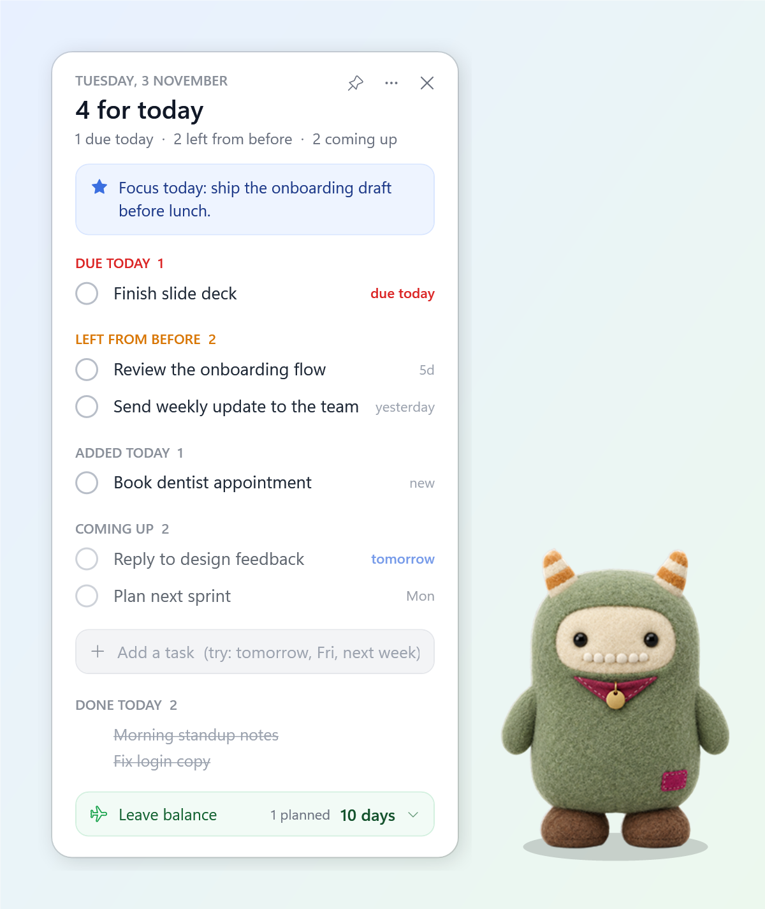
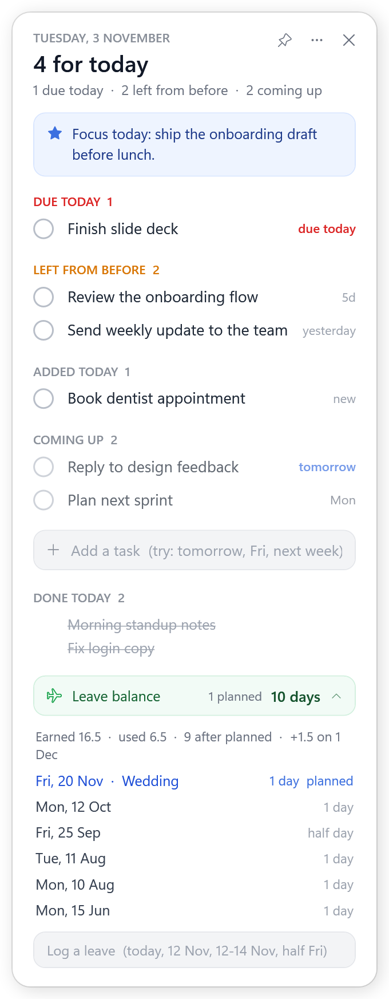

# Desk Buddy

**A plush little desk monster and a to-do widget for Windows that Claude can run for you.**



Desk Buddy sits in the corner of your screen. Click it and your list opens right next to it: what's due today, what you left from yesterday, and what's coming up. Tell Claude "remind me to send the deck tomorrow" in any chat and it shows up on your desktop a second later.

Made by [nanosphere](https://github.com/Naman7275).

## Why

To-do apps are one more tab you forget to open. Chat is easy for adding things, but hard to *see*. Desk Buddy keeps your list on the desktop, and keeps it in a plain markdown file, so you, the widget and Claude can all edit the same thing.

## Features

**The buddy**
- A soft 3D plush mascot that breathes, sways, blinks at random, smiles when you hover and squishes when you click.
- A badge with today's count: red when something is due, blue for carry-overs, a green tick when you're clear.
- Click to open or hide your list (it opens right beside the buddy, wherever you put it). Drag it anywhere.
- Stays on top of other windows, shows on every virtual desktop, and hides itself during fullscreen apps.

**The widget**
- Sections for **Due today**, **Left from yesterday / before**, **Added today** and **Coming up**, plus **Done today**.
- Type in plain words: `Finish deck tomorrow`, `Call bank Fri`, `Plan sprint next week`, `Review in 3 days`. The date is pulled out and set as the due date.
- Tick to complete, right-click to drop, click a done item to reopen it.
- Items open for more than 5 days turn amber so nothing quietly rots.
- **Morning hello:** the first time you sit down each day (after login or unlock), the widget pops up with "Good morning" and the buddy does a happy wiggle.
- **Preview tomorrow morning** (from the ⋯ menu) shows how your list will look tomorrow, on a copy of your data.

**Leave balance (optional)**
- One green line at the bottom: *Leave balance 10 days · 1 planned*.
- The monthly credit is added automatically. Log a leave with `today`, `12 Nov`, `12-14 Nov` or `half Fri`.
- Planned leaves show separately until the day comes.



**Claude integration (optional)**
- Includes a [Claude Code](https://claude.com/claude-code) skill, so Claude can add, complete, move and drop tasks, log leaves and answer "what's left?" or "what did I do yesterday?", from any chat.

## Install

Requirements: Windows 10 or 11. Nothing else; it uses the PowerShell and .NET that ship with Windows.

1. Download this repo (green **Code** button → **Download ZIP**) and unzip it somewhere permanent, e.g. `Documents\desk-buddy`.
2. Open the folder, right-click in empty space → **Open in Terminal**, and run:

```powershell
powershell -ExecutionPolicy Bypass -File install.ps1
```

Options:

| Flag | What it does |
|---|---|
| `-WithClaude` | Installs the Claude Code skill to `~\.claude\skills\desk-buddy` |
| `-WithLeaves` | Creates `leaves.md` so the leave balance line appears |
| `-NoStartup` | Doesn't start Desk Buddy with Windows |

After installing, find **Desk Buddy** in the Start menu any time. To remove it, run `uninstall.ps1` (your files are kept).

## Your data

Everything lives in two plain text files next to the scripts. They're ignored by git, so your data never ends up in a repo.

**`tasks.md`**

```markdown
## Note from Claude
Focus today: ship the onboarding draft before lunch.

## Open (carry over until done)
- [ ] Review the onboarding flow (added 2026-10-29)
- [ ] Finish slide deck (added 2026-11-02) (due 2026-11-03)

## Daily log
### 2026-11-03 (Tuesday)
- Done: Fix login copy
```

**`leaves.md`**

```markdown
## Policy
- Credit: 1.5 per month from 2026-01
- Days off: Sat, Sun

## Taken
- 2026-06-15 1
- 2026-09-25 0.5
- 2026-11-20 1 Wedding
```

Change the credit and days off to match your workplace. A month without a day (`2026-03 2`) works when you don't remember exact dates, and a negative number gives days back (comp-off).

See [`examples/`](examples) for full sample files.

## Using it with Claude

Install with `-WithClaude`, then just talk normally in Claude Code or the Claude desktop app:

> remind me to email Priya about the contract on Friday
> done with the slide deck
> move the sprint planning to next week
> took a half day today
> what's my leave balance?

Claude edits the files and the widget updates within a couple of seconds. You can also set the blue note at the top: *"put 'ship the draft before lunch' on my widget"*.

**Tip:** pair it with a scheduled Claude task in the evening ("ask me what I got done and update my list") and one in the morning ("set today's focus note").

## Customising

- **Mascot:** replace `mascot/buddy-open.png`, `buddy-blink.png` and `buddy-happy.png` with your own character (same size, transparent background). Any style works.
- **Colours and layout:** the widget is plain WPF XAML inside `widget.ps1`.
- **Test another day:** `widget.ps1 -LogFile <copy of tasks.md> -Today 2026-12-01`
- **Screenshot:** add `-Snapshot out.png` (and `-OpenLeave`) to render the widget to an image.

## How it works

- `widget.ps1`: the WPF widget and buddy. Polls the files every 1.5 s and re-renders when they change.
- `worklog-core.ps1`: reads and writes `tasks.md` / `leaves.md`, and parses dates like "tomorrow", "Fri", "12-14 Nov".
- `Start widget.vbs`: launches it without a console window.

## Credits

Mascot art was generated with AI image tools and hand-edited for the blink and smile frames. Code and art are released under the [MIT licence](LICENSE).
